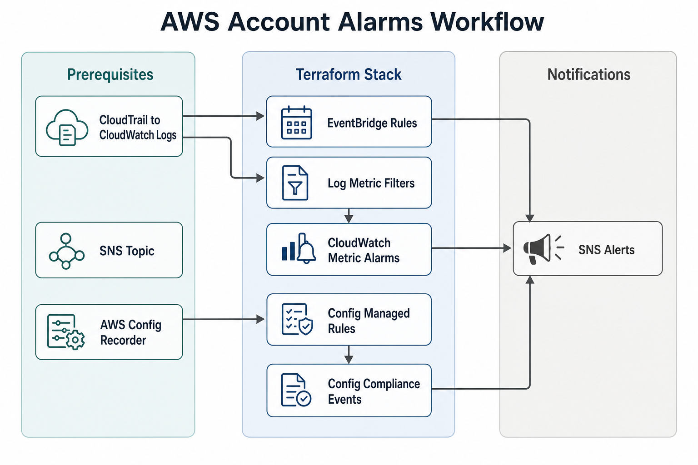

# Alarmas AWS a nivel de cuenta

[English](README.md) | Español

Stack raíz de Terraform que despliega monitoreo de seguridad y uso a nivel de cuenta en AWS. Crea reglas de EventBridge, filtros de métricas de CloudWatch Logs, alarmas de métricas de CloudWatch y reglas managed de AWS Config. Los destinos de notificación, la entrega de CloudTrail y el recorder de Config **no** se crean aquí; deben existir de antemano y se pasan como variables.



## Características

- Cumplimiento por inactividad / rotación de access keys y alarmas por uso en ráfaga
- Notificaciones de inicio de sesión no autorizado o sospechoso en la consola
- Monitoreo de cambios en políticas y roles de IAM
- Monitoreo de cambios en Security Groups / Network ACLs
- Monitoreo de cambios en bucket policies y Block Public Access de S3
- Reglas de Security Group abiertas a `0.0.0.0/0` o `::/0`
- Monitoreo de borrado de log groups/streams de CloudWatch
- Señales de uso inusual en EC2, S3 y RDS (basadas en CloudTrail y alarmas opcionales por recurso)
- Monitoreo de cambios en CloudTrail y servicios críticos (cobertura ampliada de deshabilitación GuardDuty / Security Hub)
- Reglas de cumplimiento managed de AWS Config con notificaciones `NON_COMPLIANT`

## Prerrequisitos

Antes de aplicar este stack, asegurate de que la cuenta destino ya tenga:

1. **CloudTrail** entregando eventos de management a un grupo de CloudWatch Logs (el nombre que pasás en `cloudtrail_log_group_name`).
2. **Topic(s) SNS** cuyos ARNs pases en `alarm_actions` (y opcionalmente `ok_actions` / `insufficient_data_actions`).
3. **Policy del topic SNS** que permita publicar desde CloudWatch Alarms y EventBridge, por ejemplo:
   - `cloudwatch.amazonaws.com`
   - `events.amazonaws.com`
4. **AWS Config** con configuration recorder y delivery channel activos cuando `enable_config_compliance = true`.
5. El ARN del rol de servicio de Config en `config_role_arn` (se usa como precondition de despliegue; el recorder ya debe usar un rol adecuado).

Este stack **no** crea topics SNS, trails de CloudTrail, recorders de Config ni claves KMS.

## Arquitectura

| Mecanismo | Casos de uso |
|---|---|
| Reglas EventBridge | Login fallido, login sin MFA, actividad root, cambios IAM, manipulación de CloudTrail, servicios críticos, cambios SG/NACL, políticas/BPA S3, borrado de logs CloudWatch, Config `NON_COMPLIANT` |
| Filtros de métricas + alarmas CloudWatch | Ráfaga de API con access key, gestión de access keys, picos de lanzamiento EC2, ráfaga API S3, cambios RDS, volumen de AccessDenied, SG abierto a `0.0.0.0/0` |
| Reglas managed de AWS Config | Rotación de access keys, credenciales sin uso, MFA root, acceso público S3, cifrado EBS/RDS, CloudTrail habilitado, política de contraseñas |

## Nombres

Todos los nombres lógicos se definen en `locals.tf` y siguen el patrón:

```text
tf-account-<account_alias>-<resource-type>
```

Ejemplos:

- `tf-account-prod-unauthorized-console-login`
- `tf-account-prod-access-key-api-burst`
- `tf-account-prod-access-keys-rotated`

## Estructura del repositorio

| Archivo | Propósito |
|---|---|
| `versions.tf` | Restricciones de versión de Terraform y provider |
| `providers.tf` | Región del provider AWS |
| `variables.tf` | Inputs, flags `enable_*`, umbrales |
| `locals.tf` | Mapas de nombres, patrones de eventos, definiciones de filtros |
| `data.tf` | Identidad del caller y región |
| `eventbridge_security.tf` | Reglas EventBridge y targets SNS |
| `metric_filters.tf` | Filtros de métricas de CloudWatch Logs sobre CloudTrail |
| `cloudwatch_alarms.tf` | Alarmas de métricas y opcionales por recurso |
| `config_rules.tf` | Reglas managed de AWS Config |
| `outputs.tf` | ARNs de recursos y resumen por categoría |
| `dev.tfvars` / `stage.tfvars` / `prod.tfvars` | Valores por entorno |

## Catálogo de monitoreo

### Reglas EventBridge

| Clave | Severidad | Disparador |
|---|---|---|
| `unauthorized_console_login` | critical | `ConsoleLogin` con `errorCode` presente |
| `console_login_without_mfa` | high | `ConsoleLogin` con `MFAUsed = No` |
| `root_account_activity` | critical | Eventos CloudTrail / consola con `userIdentity.type = Root` |
| `iam_changes` | high | APIs de creación / actualización / eliminación de políticas y roles IAM |
| `cloudtrail_changes` | critical | `StopLogging`, `DeleteTrail`, `UpdateTrail` |
| `critical_service_changes` | critical | Deshabilitar/programar borrado KMS; deshabilitar Security Hub / standards / disassociate; GuardDuty delete/update/stop monitoring/disassociate; IAM `CreateUser` / `CreateAccessKey` |
| `config_non_compliant` | high | Resultado de evaluación Config `NON_COMPLIANT` |
| `network_acl_sg_changes` | high | APIs de creación / modificación / borrado de Security Groups y Network ACLs |
| `s3_policy_changes` | critical | `Put/DeleteBucketPolicy`, `Put/DeleteBucketPublicAccessBlock`, cambios BPA a nivel cuenta |
| `cloudwatch_log_deletion` | high | `DeleteLogGroup`, `DeleteLogStream` |

### Filtros de métricas y alarmas CloudWatch

| Clave | Métrica | Idea de umbral por defecto |
|---|---|---|
| `access_key_api_burst` | Eventos con `userIdentity.accessKeyId` | Cantidad de ráfaga configurable |
| `access_key_management` | `CreateAccessKey` / `UpdateAccessKey` | Alerta ante cualquier evento (`> 0`) |
| `ec2_run_instances_spike` | `RunInstances` / `StartInstances` | Pico configurable |
| `s3_api_burst` | S3 `GetObject` / `PutObject` / `DeleteObject` | Ráfaga configurable |
| `rds_change_spike` | `CreateDBInstance` / `ModifyDBInstance` | Alerta ante cualquier evento (`> 0`) |
| `access_denied` | `AccessDenied*` / `*UnauthorizedOperation` | Volumen configurable |
| `open_security_group` | `AuthorizeSecurityGroupIngress/Egress` a `0.0.0.0/0` o `::/0` | Alerta ante cualquier evento (`> 0`) |

La detección de Security Group abierto usa un **metric filter** (no EventBridge), porque el matching anidado de CIDR en `ipPermissions` de CloudTrail no es confiable en patrones EventBridge. La actividad más amplia de APIs SG/NACL sigue cubierta por la regla EventBridge `network_acl_sg_changes`.

Las métricas custom se publican bajo el namespace definido por `metric_namespace` (por defecto `AccountSecurity`).

### Alarmas opcionales por recurso

Cuando se informan listas y el flag `enable_*` correspondiente está en `true`:

| Variable | Alarma |
|---|---|
| `ec2_instance_ids` | `CPUUtilization` por instancia |
| `s3_bucket_names` | `BucketSizeBytes` por bucket |
| `rds_db_instance_identifiers` | `CPUUtilization`, `FreeStorageSpace`, `DatabaseConnections` |

### Reglas managed de AWS Config

| Clave | Identificador managed | Propósito |
|---|---|---|
| `access_keys_rotated` | `ACCESS_KEYS_ROTATED` | Edad / rotación de access keys |
| `iam_user_unused_credentials` | `IAM_USER_UNUSED_CREDENTIALS_CHECK` | Credenciales IAM sin uso |
| `root_account_mfa_enabled` | `ROOT_ACCOUNT_MFA_ENABLED` | MFA en root |
| `s3_bucket_public_read_prohibited` | `S3_BUCKET_PUBLIC_READ_PROHIBITED` | Sin lectura pública en S3 |
| `s3_bucket_public_write_prohibited` | `S3_BUCKET_PUBLIC_WRITE_PROHIBITED` | Sin escritura pública en S3 |
| `encrypted_volumes` | `ENCRYPTED_VOLUMES` | Volúmenes EBS cifrados |
| `rds_storage_encrypted` | `RDS_STORAGE_ENCRYPTED` | Almacenamiento RDS cifrado |
| `cloudtrail_enabled` | `CLOUD_TRAIL_ENABLED` | CloudTrail habilitado |
| `iam_password_policy` | `IAM_PASSWORD_POLICY` | Política de contraseñas fuerte |

Las reglas Config de access keys se crean solo cuando `enable_config_compliance` y `enable_access_key_monitoring` están en `true`.

## Cómo usarlo

Reemplazá los placeholders de account IDs, ARNs de SNS, ARN del rol de Config y nombre del log group de CloudTrail en el `.tfvars` correspondiente.

### Inicializar

```bash
terraform init
```

### Plan / apply por entorno

```bash
terraform plan  -var-file=dev.tfvars
terraform apply -var-file=dev.tfvars

terraform plan  -var-file=stage.tfvars
terraform apply -var-file=stage.tfvars

terraform plan  -var-file=prod.tfvars
terraform apply -var-file=prod.tfvars
```

### Ejemplo de overrides

```hcl
enable_s3_usage_alarms = true
s3_bucket_names        = ["my-app-assets"]

enable_ec2_usage_alarms = true
ec2_instance_ids        = ["i-0123456789abcdef0"]

enable_rds_usage_alarms = true
rds_db_instance_identifiers = ["orders-db"]
```

## Perfiles por entorno

| Setting | `dev.tfvars` | `stage.tfvars` | `prod.tfvars` |
|---|---|---|---|
| Umbrales de ráfaga | Más permisivos | Intermedios | Más estrictos |
| Familias de uso S3 / RDS | Mayormente apagadas | Encendidas | Encendidas |
| Acciones OK / insufficient-data | Vacías | OK cargado | OK + insufficient-data cargados |
| Listas por recurso | Placeholders vacíos | Placeholders vacíos | Placeholders vacíos (completar con inventario) |

## Variables importantes

| Nombre | Descripción |
|---|---|
| `account_alias` | Segmento del prefijo de nombres |
| `environment` | Tag de entorno |
| `aws_region` | Región del provider |
| `alarm_actions` | ARNs SNS (u otros) para ALARM / targets de EventBridge |
| `cloudtrail_log_group_name` | Log group existente CloudTrail → Logs |
| `config_role_arn` | ARN del rol de servicio de Config (requerido si las reglas Config están habilitadas) |
| `enable_*` | Toggles por familia de monitoreo (incluye red, políticas S3, SG abierto, borrado de logs) |
| Variables de umbral / periodo | Ajustan la sensibilidad de las alarmas |
| `ec2_instance_ids`, `s3_bucket_names`, `rds_db_instance_identifiers` | Alarmas opcionales por recurso |

## Outputs

| Nombre | Descripción |
|---|---|
| `name_prefix` | Prefijo compartido de nombres |
| `account_id` / `region` | Identidad de despliegue resuelta |
| `eventbridge_rule_arns` | ARNs de reglas EventBridge por clave |
| `metric_filter_names` | Nombres de filtros de métricas por clave |
| `cloudwatch_alarm_arns` / `cloudwatch_alarm_names` | Listas planas de alarmas |
| `cloudwatch_alarms_by_type` | Alarmas agrupadas por tipo |
| `config_rule_arns` / `config_rule_names` | Reglas Config por clave |
| `resources_by_category` | Resumen por categoría para auditoría |

## Notas de coste y ruido

- Los filtros de métricas evalúan cada evento de log coincidente en el log group de CloudTrail; cuentas con mucho tráfico pueden subir el costo de CloudWatch Logs y métricas custom.
- Las reglas managed de Config generan cargos de evaluación mientras el recorder esté activo.
- Los defaults de dev suben a propósito algunos umbrales de ráfaga y apagan familias S3/RDS para reducir ruido.
- El login a consola sin MFA puede ser ruidoso si federation o flujos break-glass no usan MFA; deshabilitá `enable_console_security_monitoring` o esa familia de reglas si hace falta.
- Si Security Hub o GuardDuty ya cubren detecciones solapadas, usá los flags `enable_*` para evitar alertas duplicadas.

## Extensiones futuras

- Filtrado geográfico / allow-list CIDR para IPs inusuales de login a consola
- Conformance Packs de AWS Config para cobertura CIS / FSBP más amplia
- Topics SNS por severidad (warning vs critical) mediante listas de acciones separadas

## Requisitos

| Nombre | Versión |
|---|---|
| Terraform | `>= 1.5.0` |
| hashicorp/aws | `>= 5.0` |
