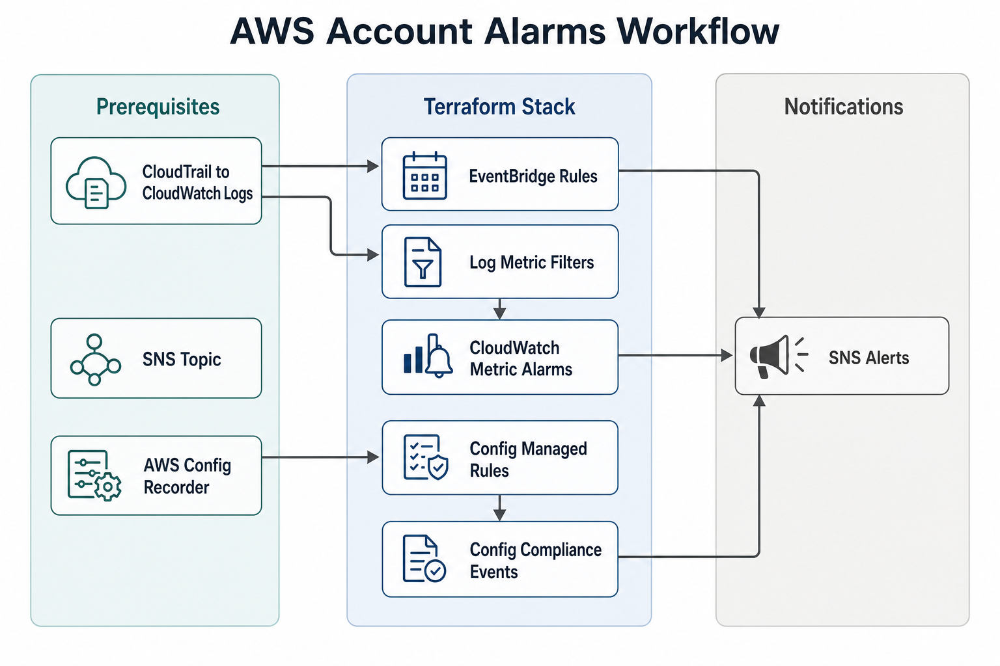

# AWS Account-Level Alarms

English | [Español](README.es.md)

Root Terraform stack that deploys account-level security and usage monitoring for AWS. It creates EventBridge rules, CloudWatch Logs metric filters, CloudWatch metric alarms, and AWS Config managed rules. Notification targets, CloudTrail log delivery, and the Config recorder are **not** created here; they must already exist and are passed in as variables.



## Features

- Access key inactivity / rotation compliance and burst usage alarms
- Unauthorized and suspicious console sign-in notifications
- IAM policy and role change monitoring
- Security Group / Network ACL change monitoring
- S3 bucket policy and Block Public Access change monitoring
- Open Security Group rules to `0.0.0.0/0` or `::/0`
- CloudWatch Logs deletion monitoring
- Unusual EC2, S3, and RDS usage signals (CloudTrail-based and optional per-resource alarms)
- CloudTrail and critical-service change monitoring (expanded GuardDuty / Security Hub disable coverage)
- AWS Config managed compliance rules with NON_COMPLIANT notifications

## Prerequisites

Before applying this stack, ensure the target account already has:

1. **CloudTrail** delivering management events to a CloudWatch Logs group (the name you pass as `cloudtrail_log_group_name`).
2. **SNS topic(s)** whose ARNs you pass in `alarm_actions` (and optionally `ok_actions` / `insufficient_data_actions`).
3. **SNS topic policy** allowing publish from CloudWatch Alarms and EventBridge, for example:
   - `cloudwatch.amazonaws.com`
   - `events.amazonaws.com`
4. **AWS Config** with an active configuration recorder and delivery channel when `enable_config_compliance = true`.
5. The Config service role ARN in `config_role_arn` (used as a deployment precondition; the recorder must already use a suitable role).

This stack does **not** create SNS topics, CloudTrail trails, Config recorders, or KMS keys.

## Architecture

| Mechanism | Use cases |
|---|---|
| EventBridge rules | Failed console login, login without MFA, root activity, IAM changes, CloudTrail tampering, critical service changes, SG/NACL changes, S3 policy/BPA changes, CloudWatch log deletion, Config NON_COMPLIANT |
| Metric filters + CloudWatch alarms | Access key API burst, access key management, EC2 launch spikes, S3 API burst, RDS changes, AccessDenied volume, open SG to `0.0.0.0/0` |
| AWS Config managed rules | Access key rotation, unused credentials, root MFA, S3 public access, EBS/RDS encryption, CloudTrail enabled, password policy |

## Naming

All logical names are defined in `locals.tf` and follow:

```text
tf-account-<account_alias>-<resource-type>
```

Examples:

- `tf-account-prod-unauthorized-console-login`
- `tf-account-prod-access-key-api-burst`
- `tf-account-prod-access-keys-rotated`

## Repository layout

| File | Purpose |
|---|---|
| `versions.tf` | Terraform and provider version constraints |
| `providers.tf` | AWS provider region |
| `variables.tf` | Inputs, enable flags, thresholds |
| `locals.tf` | Naming maps, event patterns, filter definitions |
| `data.tf` | Caller identity and region |
| `eventbridge_security.tf` | EventBridge rules and SNS targets |
| `metric_filters.tf` | CloudWatch Logs metric filters on CloudTrail |
| `cloudwatch_alarms.tf` | Metric and optional per-resource alarms |
| `config_rules.tf` | AWS Config managed rules |
| `outputs.tf` | Resource ARNs and category summary |
| `dev.tfvars` / `stage.tfvars` / `prod.tfvars` | Environment-specific values |

## Monitoring catalog

### EventBridge rules

| Key | Severity | Trigger |
|---|---|---|
| `unauthorized_console_login` | critical | `ConsoleLogin` with `errorCode` present |
| `console_login_without_mfa` | high | `ConsoleLogin` with `MFAUsed = No` |
| `root_account_activity` | critical | CloudTrail / console events from `userIdentity.type = Root` |
| `iam_changes` | high | IAM policy and role create / update / delete APIs |
| `cloudtrail_changes` | critical | `StopLogging`, `DeleteTrail`, `UpdateTrail` |
| `critical_service_changes` | critical | KMS key disable/delete schedule; Security Hub disable / standards disable / disassociate; GuardDuty detector delete/update/stop monitoring/disassociate; IAM `CreateUser` / `CreateAccessKey` |
| `config_non_compliant` | high | Config rule evaluation result `NON_COMPLIANT` |
| `network_acl_sg_changes` | high | Security Group and Network ACL create / modify / delete APIs |
| `s3_policy_changes` | critical | `Put/DeleteBucketPolicy`, `Put/DeleteBucketPublicAccessBlock`, account-level BPA changes |
| `cloudwatch_log_deletion` | high | `DeleteLogGroup`, `DeleteLogStream` |

### CloudWatch metric filters and alarms

| Key | Metric | Default threshold idea |
|---|---|---|
| `access_key_api_burst` | Events with `userIdentity.accessKeyId` | Configurable burst count |
| `access_key_management` | `CreateAccessKey` / `UpdateAccessKey` | Alert on any event (`> 0`) |
| `ec2_run_instances_spike` | `RunInstances` / `StartInstances` | Configurable spike count |
| `s3_api_burst` | S3 `GetObject` / `PutObject` / `DeleteObject` | Configurable burst count |
| `rds_change_spike` | `CreateDBInstance` / `ModifyDBInstance` | Alert on any event (`> 0`) |
| `access_denied` | `AccessDenied*` / `*UnauthorizedOperation` | Configurable volume |
| `open_security_group` | `AuthorizeSecurityGroupIngress/Egress` to `0.0.0.0/0` or `::/0` | Alert on any event (`> 0`) |

Open Security Group detection uses a **metric filter** (not EventBridge) because nested CloudTrail `ipPermissions` CIDR matching is unreliable in EventBridge patterns. Broader SG/NACL API activity is still covered by the `network_acl_sg_changes` EventBridge rule.

Custom metrics are published under the namespace set by `metric_namespace` (default `AccountSecurity`).

### Optional per-resource alarms

When lists are provided and the matching `enable_*` flag is true:

| Variable | Alarm |
|---|---|
| `ec2_instance_ids` | `CPUUtilization` per instance |
| `s3_bucket_names` | `BucketSizeBytes` per bucket |
| `rds_db_instance_identifiers` | `CPUUtilization`, `FreeStorageSpace`, `DatabaseConnections` |

### AWS Config managed rules

| Key | Managed identifier | Purpose |
|---|---|---|
| `access_keys_rotated` | `ACCESS_KEYS_ROTATED` | Access key age / rotation |
| `iam_user_unused_credentials` | `IAM_USER_UNUSED_CREDENTIALS_CHECK` | Unused IAM credentials |
| `root_account_mfa_enabled` | `ROOT_ACCOUNT_MFA_ENABLED` | Root MFA |
| `s3_bucket_public_read_prohibited` | `S3_BUCKET_PUBLIC_READ_PROHIBITED` | No public S3 read |
| `s3_bucket_public_write_prohibited` | `S3_BUCKET_PUBLIC_WRITE_PROHIBITED` | No public S3 write |
| `encrypted_volumes` | `ENCRYPTED_VOLUMES` | Encrypted EBS volumes |
| `rds_storage_encrypted` | `RDS_STORAGE_ENCRYPTED` | Encrypted RDS storage |
| `cloudtrail_enabled` | `CLOUD_TRAIL_ENABLED` | CloudTrail enabled |
| `iam_password_policy` | `IAM_PASSWORD_POLICY` | Strong account password policy |

Access-key Config rules are created only when both `enable_config_compliance` and `enable_access_key_monitoring` are true.

## How to use

Replace placeholder account IDs, SNS ARNs, Config role ARNs, and CloudTrail log group names in the corresponding `.tfvars` file.

### Initialize

```bash
terraform init
```

### Plan / apply per environment

```bash
terraform plan  -var-file=dev.tfvars
terraform apply -var-file=dev.tfvars

terraform plan  -var-file=stage.tfvars
terraform apply -var-file=stage.tfvars

terraform plan  -var-file=prod.tfvars
terraform apply -var-file=prod.tfvars
```

### Example overrides

```hcl
enable_s3_usage_alarms = true
s3_bucket_names        = ["my-app-assets"]

enable_ec2_usage_alarms = true
ec2_instance_ids        = ["i-0123456789abcdef0"]

enable_rds_usage_alarms = true
rds_db_instance_identifiers = ["orders-db"]
```

## Environment profiles

| Setting | `dev.tfvars` | `stage.tfvars` | `prod.tfvars` |
|---|---|---|---|
| Burst thresholds | More permissive | Intermediate | Stricter |
| S3 / RDS usage families | Mostly off | On | On |
| OK / insufficient-data actions | Empty | OK filled | OK + insufficient-data filled |
| Per-resource lists | Empty placeholders | Empty placeholders | Empty placeholders (fill with inventory) |

## Important variables

| Name | Description |
|---|---|
| `account_alias` | Naming prefix segment |
| `environment` | Environment tag |
| `aws_region` | Provider region |
| `alarm_actions` | SNS (or other) ARNs for ALARM / EventBridge targets |
| `cloudtrail_log_group_name` | Existing CloudTrail → Logs group |
| `config_role_arn` | Existing Config service role ARN (required when Config rules are enabled) |
| `enable_*` | Feature toggles per monitoring family (includes network, S3 policy, open SG, log deletion) |
| Threshold / period variables | Tune metric alarm sensitivity |
| `ec2_instance_ids`, `s3_bucket_names`, `rds_db_instance_identifiers` | Optional resource-scoped alarms |

## Outputs

| Name | Description |
|---|---|
| `name_prefix` | Shared resource name prefix |
| `account_id` / `region` | Resolved deployment identity |
| `eventbridge_rule_arns` | EventBridge rule ARNs by key |
| `metric_filter_names` | Metric filter names by key |
| `cloudwatch_alarm_arns` / `cloudwatch_alarm_names` | Flat alarm lists |
| `cloudwatch_alarms_by_type` | Alarms grouped by type |
| `config_rule_arns` / `config_rule_names` | Config rules by key |
| `resources_by_category` | Audit-friendly category summary |

## Cost and noise notes

- Metric filters evaluate every matching log event in the CloudTrail log group; busy accounts can increase CloudWatch Logs and custom metric costs.
- Config managed rules incur Config evaluation charges while the recorder is active.
- Dev defaults intentionally raise some burst thresholds and disable S3/RDS usage families to reduce noise.
- Console login without MFA can be noisy if federation or break-glass workflows do not use MFA; disable `enable_console_security_monitoring` or remove that rule family if needed.
- If Security Hub or GuardDuty already covers overlapping detections, use the `enable_*` flags to avoid duplicate paging.

## Future extensions

- Geo / CIDR allow-list filtering for unusual console login source IPs
- AWS Config Conformance Packs for broader CIS / FSBP coverage
- Severity-tiered SNS topics (warning vs critical) via separate action lists

## Requirements

| Name | Version |
|---|---|
| Terraform | `>= 1.5.0` |
| hashicorp/aws | `>= 5.0` |
