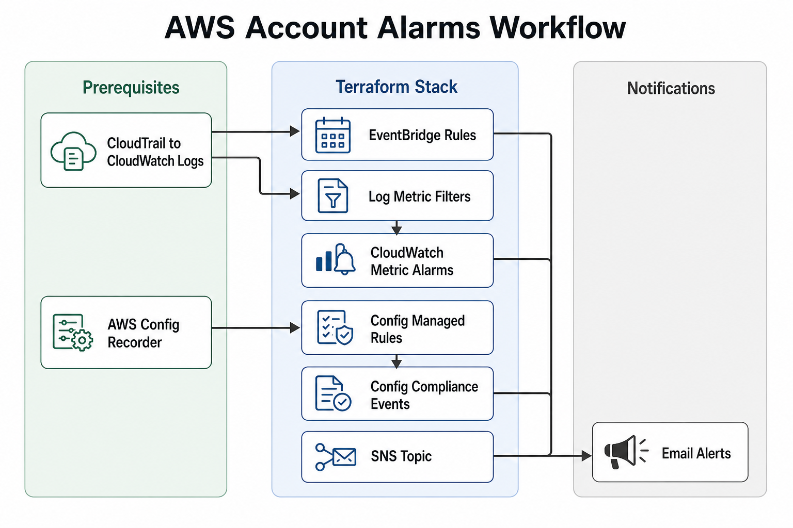

# ☁️ Account-level AWS security alarms with Terraform: EventBridge, Config, CloudWatch, and SNS

### How to detect sensitive account changes (IAM, console, open SGs, CloudTrail) and get email alerts without wiring everything by hand.

I’ve been asking myself the same question for a while: who alerts me if someone opens a Security Group to `0.0.0.0/0`, if a console login fails, or if GuardDuty gets disabled?

CPU alarms on an EC2 instance are useful — but they are not enough. The expensive risks often live at **account level**: IAM, CloudTrail, S3 policies, Config drift, and security services.

In this article I’ll walk you through a reusable Terraform stack I built for that: account-level alarms and rules, with managed SNS + email, ready for `dev` / `stage` / `prod`.

📦 Repo: [Aws.Alarms.Module.Terraform](https://github.com/agustinafassina/Aws.Alarms.Module.Terraform)

---

## ❓ The problem: resource monitoring ≠ account protection

If you only watch per-instance or per-database metrics, you can miss:

- 🔑 Suspicious access key creation or burst usage
- 🚪 Failed console logins or logins without MFA
- 👤 IAM role and policy changes
- 🚨 Someone stopping CloudTrail or disabling Security Hub
- 🌐 A Security Group opened to the internet
- ✅ Compliance drift (public S3, root without MFA, and more)

I wanted something **deployable per environment**, with `enable_*` flags, centralized naming, and email notifications without depending on an SNS topic created somewhere else.

---

## 🛠️ What we built

A Terraform **root stack** that creates:

- 📬 A managed SNS topic + email subscriptions
- ⚡ EventBridge rules for sensitive API / console events
- 📈 CloudTrail log metric filters + CloudWatch alarms
- ✅ AWS Config managed rules + alerts when evaluations become `NON_COMPLIANT`

It does **not** create CloudTrail or the Config recorder. Those should already exist (one trail / recorder per account is the usual pattern).

You get `dev.tfvars`, `stage.tfvars`, and `prod.tfvars` with different thresholds and feature flags.

---

## 🏗️ Architecture (three detection paths)



<!-- MEDIUM EDIT: replace the 3 bullets below in the published EN post (image already updated). -->
<!-- OLD on Medium:
- EventBridge — Near real-time: login, IAM, CloudTrail, SG/NACL, S3 policy/BPA, log deletion, critical services
- Metric filters + alarms — Patterns in CloudTrail logs: access key bursts, EC2/S3/RDS spikes, SG open to 0.0.0.0/0
- AWS Config — Continuous compliance + NON_COMPLIANT notifications
-->
- **EventBridge** — Near real-time from CloudTrail **management events** (native, not via Logs): login, IAM, CloudTrail tampering, SG/NACL, S3 policy/BPA, log deletion, critical services
- **Metric filters + alarms** — Patterns in the CloudTrail → **CloudWatch Logs** group: access key bursts, EC2/S3/RDS spikes, SG open to `0.0.0.0/0`
- **AWS Config** — Continuous compliance + `NON_COMPLIANT` notifications

Everything lands on SNS — and from there, in your inbox.

---

## 🚨 What it covers (short list)

- 🔑 Access keys (burst usage, create/update, rotation / unused credentials via Config)
- 🚪 Console: failed login, no MFA, root activity
- 👤 IAM policy and role changes
- 🛡️ Network: Security Groups / NACLs
- 🪣 S3: bucket policy and Block Public Access
- 🌐 SG rules opened to `0.0.0.0/0` or `::/0`
- 🚨 CloudTrail stop/delete/update + disabling GuardDuty / Security Hub
- 🗑️ CloudWatch Logs deletion
- 📈 Unusual EC2 / S3 / RDS usage (plus optional per-resource alarms)
- ✅ Config: root MFA, public S3, EBS/RDS encryption, password policy, and more

Each family can be toggled with an `enable_*` flag.

---

## 🧩 Terraform design choices

### 🏷️ Names live in `locals.tf`

All logical names follow one pattern:

```text
tf-account-<account_alias>-<resource-type>
```

Example: `tf-account-prod-unauthorized-console-login`

### 📬 SNS + email included

With `create_sns_topic = true` the stack creates:

- Topic `tf-account-<alias>-alerts`
- Email subscriptions for every address in `notification_emails`
- A topic policy so CloudWatch and EventBridge can publish

After `apply`, **confirm the SNS subscription email**. Until you do, alerts will not arrive.

### 🎛️ `enable_*` flags

In `dev` you can turn off noisy families (for example log deletion or S3/RDS usage). In `prod`, most families stay on with stricter thresholds.

---

## 🚀 How to use it

Account prerequisites:

1. CloudTrail delivering management events to a CloudWatch Logs group
2. AWS Config with an active recorder (if you enable compliance)
3. The Config service role ARN in `config_role_arn`

Minimal variables example:

```hcl
account_alias = "dev"
environment   = "dev"
aws_region    = "eu-west-1"

create_sns_topic = true
notification_emails = [
  "ops@example.com",
]

cloudtrail_log_group_name = "/aws/cloudtrail/dev"
config_role_arn           = "arn:aws:iam::123456789012:role/aws-config-role-dev"
```

Deploy:

```bash
terraform init
terraform plan  -var-file=dev.tfvars
terraform apply -var-file=dev.tfvars
```

Confirm the SNS email — EventBridge rules and CloudWatch alarms already target the topic.

Prefer an existing SNS topic?

```hcl
create_sns_topic = false
alarm_actions    = ["arn:aws:sns:eu-west-1:123456789012:existing-alerts"]
```

---

## ⚖️ Trade-offs worth knowing

- **We do not create CloudTrail/Config**: we avoid duplicating control-plane resources; this stack focuses on detection and alerting.
- **Security Group open to the world**: detected with a **metric filter** (more reliable for nested CIDRs in CloudTrail). The EventBridge network rule still covers broader SG/NACL APIs.
- **Console login without MFA** can be noisy with federation or break-glass flows — disable that family if needed.
- Metric filters and Config have a **cost** in very chatty accounts: tune thresholds per environment.

---

## 🔭 What’s next

- CI with `fmt` / `validate` on PRs
- Geo / CIDR allow-list for unusual console logins
- Config Conformance Packs (CIS / FSBP)
- Separate SNS topics by severity (warning vs critical)

---

## 💬 Closing

If you only monitor “is the EC2 healthy?”, this stack adds the layer I cared about most: **what is happening in the account itself**.

Full code and README (EN/ES):  
[https://github.com/agustinafassina/Aws.Alarms.Module.Terraform](https://github.com/agustinafassina/Aws.Alarms.Module.Terraform)

If you use it or adapt it, I’d love your feedback.

— Agustina

---

## 🏷️ Suggested Medium tags

`AWS` · `Terraform` · `DevOps` · `CloudSecurity` · `CloudWatch`

Medium link https://medium.com/@agustinafassina_92108/%EF%B8%8F-account-level-aws-security-alarms-with-terraform-eventbridge-config-cloudwatch-and-sns-1e55de429c2e
